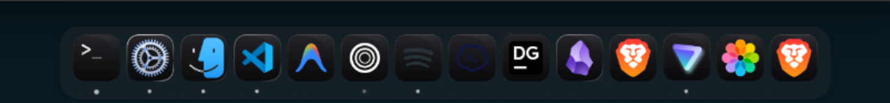

# macOS Tahoe Dotfiles for KDE Plasma 6

A macOS Tahoe inspired desktop configuration for **KDE Plasma 6 (Wayland)** on **CachyOS / Arch Linux**. The repository contains the full desktop configuration, custom theme packages, patches, and a small Python toolchain used to install and synchronize everything.

The layout is organized by domain so that desktop, shell, application, theme, and tooling files are easy to find and maintain. Theme-specific configuration is separated from shared configuration and selected at install time.

## Screenshots



## Overview

| Component | Choice |
| :--- | :--- |
| OS | CachyOS x86_64 (Arch Linux) |
| Desktop environment | KDE Plasma 6 (Wayland) |
| Application style | [Darkly](https://github.com/Bali1058/Darkly), translucent with rounded corners and blur |
| GTK theme | [MacTahoe-gtk-theme](https://github.com/vinceliuice/MacTahoe-gtk-theme), light and dark variants |
| Window decoration | [Klassy](https://github.com/paulmcauley/klassy), macOS-style left-aligned buttons |
| Global theme | `MY LIGHT TAHOE` and `MY TAHOE DARK` custom Look-and-Feel packages |
| Plasma style | `MacTahoe-Light` and `MacTahoe-Dark` |
| Icon theme | `MacTahoe` plus generated `MacTahoe-Frosted` variants |
| Cursor theme | `MacTahoe-dark` |
| System font | SF Pro Display, 10pt |
| Monospace font | SF Mono, 10pt |
| Launcher | [Albert](https://albertlauncher.github.io/) on `Meta+Space`, MacTahoe Glass theme |
| Top panel | Apple menu, global menu, active window title, system tray, digital clock |
| Dock | Floating Plasma panel with icon tasks and a trash can widget |
| Shell and prompt | Zsh with [Starship](https://starship.rs/) |
| Terminals | Konsole and Alacritty |

## Architecture

The repository follows a domain-oriented layout:

- `desktop/` contains Plasma, KWin, decoration, effect, and notification applet files.
- `themes/` contains the active light and dark overrides, plus shared GTK assets and color schemes.
- `shell/` contains Zsh, Konsole, Alacritty, CAVA, and Starship configuration.
- `apps/` contains application-specific configuration for Dolphin and Albert.
- `tooling/` contains the icon conversion package, developer scripts, and tests.
- `installer/` contains the installer, the sync script, shared path mappings, and package list.
- `assets/` contains patches and standalone icon assets used by the installer.

Two ideas keep the repository predictable:

1. **Shared configuration lives once.** Panel layout, KWin rules, decorations, shell configuration, applications, shared GTK CSS, and custom Plasma packages are not duplicated per theme.
2. **Theme-specific configuration is isolated.** The eight files that control the active color appearance live in `themes/light/` and `themes/dark/` with identical relative paths.

Both `installer/install.py` and `installer/sync.py` read the same path definitions from `installer/manifest.py`. Adding a new managed file therefore only requires one manifest change, not two separate script changes.

## Repository Structure

```text
dotfiles/
├── desktop/
│   ├── decorations/
│   │   ├── darkly/
│   │   │   └── darklyrc                          # Darkly widget style: blur, radius, opacity
│   │   └── klassy/
│   │       └── windecopresetsrc                  # Klassy window decoration presets
│   ├── kwin/
│   │   ├── config/
│   │   │   ├── kwinrc                            # KWin rules, effects, multi-monitor settings
│   │   │   └── kwinrulesrc                       # Per-window rules
│   │   ├── effects/
│   │   │   └── glass-auto-tint.patch             # Custom KWin glass effect auto-tint changes
│   │   └── scripts/
│   │       ├── albertdump/                       # KWin script for Albert
│   │       └── truely-maximized/                 # KWin script for true maximization
│   ├── notifications/                            # Source for the custom Plasma notifications applet
│   │   ├── CMakeLists.txt
│   │   ├── build.sh
│   │   ├── *.qml
│   │   └── *.cpp / *.h
│   └── plasma/
│       ├── config/
│       │   ├── plasmashellrc                     # Panel geometry and visibility
│       │   └── plasma-org.kde.plasma.desktop-appletsrc
│       │                                         # Panel, widget, and dock layout
│       ├── desktoptheme/
│       │   ├── MacTahoe-Dark/                    # Dark Plasma style
│       │   └── MacTahoe-Light/                   # Light Plasma style
│       ├── look-and-feel/
│       │   ├── MY LIGHT TAHOE/                   # Light global theme package
│       │   └── MY TAHOE DARK/                    # Dark global theme package
│       └── plasmoids/
│           ├── com.github.antroids.application-title-bar/
│           ├── org.51n7.kMenu/
│           ├── org.kde.mac-tahoe-liquid-kde.launcher/
│           └── org.kde.mac-tahoe-liquid-kde.trashcan/
├── themes/
│   ├── dark/                                     # Active dark overrides
│   │   ├── .gtkrc-2.0
│   │   ├── kdeglobals
│   │   ├── xsettingsd.conf
│   │   ├── klassy/klassyrc
│   │   ├── gtk-3.0/{settings.ini,colors.css}
│   │   └── gtk-4.0/{settings.ini,colors.css}
│   ├── light/                                    # Active light overrides, same layout
│   └── shared/
│       ├── color-schemes/
│       │   ├── MacTahoeDark.colors
│       │   └── MacTahoeLight.colors
│       ├── gtk-3.0/                              # Shared GTK3 CSS, bookmarks, assets
│       └── gtk-4.0/                              # Shared GTK4 CSS, assets, window buttons
├── shell/
│   ├── alacritty/{alacritty.toml,gogh.toml}
│   ├── cava/{config,shaders/,themes/}
│   ├── konsole/
│   │   ├── konsolerc
│   │   └── profiles/                             # Color schemes, profiles, bookmarks
│   ├── starship/starship.toml
│   └── zsh/{.zshrc,.p10k.zsh}
├── apps/
│   ├── albert/
│   │   ├── applications/albert-toggle.desktop
│   │   ├── autostart/albert.desktop
│   │   ├── config/{config,websearch/engines.json}
│   │   └── share/widgetsboxmodel/themes/         # MacTahoe Albert themes
│   └── dolphin/
│       ├── applications/org.kde.dolphin.desktop
│       ├── bin/dolphin
│       ├── config/dolphinrc
│       ├── kxmlgui5/dolphin/dolphinui.rc
│       ├── kxmlgui6/dolphin/dolphinui.rc
│       └── qss/dolphin.qss
├── tooling/
│   ├── convert/                                  # SVG recoloring and frosted-glass engine
│   ├── tests/test_convert.py                     # Unit tests
│   ├── frostify.py                               # CLI wrapper around convert
│   ├── patch.py                                  # KDE and MacTahoe radius patcher
│   └── tweak-toolbar-border.py                   # Kvantum toolbar border helper
├── installer/
│   ├── install.py                                # Installer and restore script
│   ├── manifest.py                               # Shared source/destination mappings
│   ├── packages.txt                              # Arch/CachyOS packages
│   └── sync.py                                   # System-to-repository sync script
├── assets/
│   ├── icons/file-manager-clear.svg              # Patched Finder icon
│   └── patches/MacTahoe-wifi-icons/
│       ├── 24/                                   # Patched 24px Wi-Fi icons
│       └── 32/                                   # Patched 32px Wi-Fi icons
├── docs/screenshots/dock.png
└── README.md
```

## Theme Model

### Global configuration

Global files are installed regardless of the selected color theme. They define behavior and layout rather than color appearance:

- Plasma panel geometry and widget layout
- KWin rules, effects, and window behavior
- Darkly and Klassy presets
- Custom Look-and-Feel packages and Plasma styles
- Custom plasmoids and KWin scripts
- Shared GTK CSS, bookmarks, assets, and window button assets
- Shared color schemes
- Shell, terminal, Dolphin, and Albert configuration

### Theme-specific configuration

Each theme directory contains the same eight paths:

| Path inside `themes/light/` or `themes/dark/` | Installed to |
| :--- | :--- |
| `kdeglobals` | `~/.config/kdeglobals` |
| `klassy/klassyrc` | `~/.config/klassy/klassyrc` |
| `gtk-3.0/settings.ini` | `~/.config/gtk-3.0/settings.ini` |
| `gtk-3.0/colors.css` | `~/.config/gtk-3.0/colors.css` |
| `gtk-4.0/settings.ini` | `~/.config/gtk-4.0/settings.ini` |
| `gtk-4.0/colors.css` | `~/.config/gtk-4.0/colors.css` |
| `xsettingsd.conf` | `~/.config/xsettingsd/xsettingsd.conf` |
| `.gtkrc-2.0` | `~/.gtkrc-2.0` |

The light theme uses the `MY LIGHT TAHOE` Look-and-Feel package, `MacTahoe-Light` Plasma style, and light GTK/cursor settings. The dark theme uses the `MY TAHOE DARK` package, `MacTahoe-Dark` style, and dark GTK/cursor settings.

### Theme detection and precedence

The installer determines the theme in this order:

1. If `--theme light` or `--theme dark` is passed, that value is used.
2. Otherwise, `--theme auto` reads the first `ColorScheme=` line in `~/.config/kdeglobals`. A value containing `light` selects the light theme; any other value selects dark.
3. If the file is missing or cannot be read, the default is light.

Global mappings are installed first. Theme mappings are installed last so that they override any overlapping shared files.

## Requirements

### System

- CachyOS or Arch Linux
- KDE Plasma 6 running under Wayland
- Python 3.10 or newer
- `pacman` and an optional AUR helper such as `yay` or `paru`

### Packages

The package list is in `installer/packages.txt`:

```bash
yay -S - < installer/packages.txt
```

The list covers Darkly, Klassy, the Quickbar applet, `sassc`, Albert, Alacritty, CAVA, Fastfetch, Starship, and Zsh.

### External assets

These assets are not distributed with the repository:

- **MacTahoe icon theme.** Install it to `~/.local/share/icons/MacTahoe/` from the upstream release. The installer patches Wi-Fi and Finder icons inside that theme and generates frosted variants from it.
- **SF Pro Display fonts.** The installer checks for the font and, if missing, clones `apple-san-francisco-pro-fonts` into `~/.local/share/fonts/` and refreshes the font cache.
- **MacTahoe GTK theme.** If `~/.themes/MacTahoe-Dark` is missing, the installer clones `MacTahoe-gtk-theme` into a temporary directory and runs its installer with `-d ~/.themes`.

A network connection is required for the automatic font and GTK theme setup.

## Installation

Clone the repository:

```bash
git clone https://github.com/<your-username>/dotfiles.git ~/dotfiles
cd ~/dotfiles
```

Run the installer:

```bash
python3 installer/install.py
```

The default mode copies files and creates a backup of anything it replaces.

### Installer options

| Option | Description |
| :--- | :--- |
| `--theme auto` | Detect the theme from `~/.config/kdeglobals`. Default. |
| `--theme light` | Install `themes/light/` overrides. |
| `--theme dark` | Install `themes/dark/` overrides. |
| `--symlink` | Create symlinks into the repository instead of copying. |
| `--no-backup` | Do not create `~/.dotfiles_backup_<timestamp>/`. |
| `--dry-run` | Print planned actions without changing files. |
| `--install-pkgs` | Install missing packages without asking. |
| `-y`, `--yes` | Answer yes to every prompt, including package installation. |
| `--frosted none` | Skip frosted icon generation. |
| `--frosted light` | Generate only `MacTahoe-Frosted-Light`. |
| `--frosted dark` | Generate only `MacTahoe-dark`. |
| `--frosted frosted-dark` | Generate only `MacTahoe-Frosted-Dark`. |
| `--frosted all` | Generate light, dark, and frosted-dark variants. Default. |

Examples:

```bash
# Preview a light installation
python3 installer/install.py --theme light --dry-run

# Install with symlinks and a dark theme
python3 installer/install.py --theme dark --symlink

# Install without backups and without prompts
python3 installer/install.py --no-backup -y
```

### What the installer does

1. Checks `installer/packages.txt` with `pacman -Q`. If a package is not registered, it also checks whether the name exists in `PATH`. Missing packages can be installed through `yay`, `paru`, or `pacman`.
2. Creates a timestamped backup directory for files that will be replaced, unless `--no-backup` or `--dry-run` is used.
3. Resolves the active theme and installs all global mappings.
4. Installs the selected theme's eight override files.
5. Ensures SF Pro Display is available, downloading it if necessary.
6. Ensures the MacTahoe GTK theme exists in `~/.themes`.
7. Copies the patched Wi-Fi icons from `assets/patches/MacTahoe-wifi-icons/` into the installed `MacTahoe` icon theme.
8. Copies `assets/icons/file-manager-clear.svg` over the Finder icon in every matching `MacTahoe*` icon theme.
9. Generates the requested frosted icon variants with the `convert` package. For light variants it also maintains the `MacTahoe-Frosted` compatibility symlink.
10. Rebuilds the KDE service cache and icon caches, then prints a reminder to restart `plasmashell`.

### Backup behavior

Existing destinations are copied into `~/.dotfiles_backup_<timestamp>/` before replacement. Directories are copied recursively and symlinks are preserved. If a destination is a symlink, the symlink itself is backed up and then replaced.

Symlink mode is useful when actively editing the repository, because changes appear in the live configuration immediately. The tradeoff is that removing or moving repository files can break the live symlinks. Re-run the installer after switching themes or moving files.

## Syncing System Changes Back to the Repository

`installer/sync.py` performs the reverse operation: it copies the active configuration from the system back into the repository.

```bash
cd ~/dotfiles
python3 installer/sync.py
```

The script uses the same manifest as the installer and reverses each pair. Theme-specific files are written into `themes/<detected-theme>/`.

```bash
python3 installer/sync.py --theme light
python3 installer/sync.py --theme dark
```

### Sync behavior and caveats

- Directories are replaced at the destination rather than merged. Review the resulting diff before committing.
- Backup and temporary files matching `*.bak`, `*.bak.*`, `*.toml.*`, `*.tbcache`, and `*~` are ignored during directory sync.
- Symlinks are preserved. If a source symlink has an absolute target, the target is rewritten relative to the source directory so the repository stays portable.
- `sync.py` does not commit or push anything. It only updates files in the working tree.

Recommended workflow:

```bash
python3 installer/sync.py --theme light
git diff --stat
git diff
git add -A
git commit -m "Update desktop configuration"
git push
```

## Custom Assets and Patches

### Look-and-Feel packages

`desktop/plasma/look-and-feel/MY LIGHT TAHOE/` and `desktop/plasma/look-and-feel/MY TAHOE DARK/` are custom global theme packages. They define defaults for the widget style, window decoration, Plasma style, color scheme, icon theme, and cursor theme.

### Plasma styles

`desktop/plasma/desktoptheme/MacTahoe-Light/` and `MacTahoe-Dark/` are the Plasma style packages used by the Look-and-Feel defaults. They are copied as complete directories, including their icon assets.

### Plasmoids and KWin scripts

The custom plasmoids provide the Apple menu, application title bar, launcher, and trash can. The KWin scripts provide Albert integration and true maximization behavior.

### KWin glass effect patch

`desktop/kwin/effects/glass-auto-tint.patch` is a binary diff of the local changes to the KWin glass effect. It is kept as a patch rather than a full source tree. Apply it against the matching upstream source when rebuilding the effect.

### Wi-Fi and Finder icon patches

The Wi-Fi patch contains replacement SVGs for `status/24` and `status/32` inside the MacTahoe icon theme. The Finder patch replaces `apps/scalable/file-manager.svg` in every `MacTahoe*` theme with the clear dual-face icon.

### Custom notifications applet

`desktop/notifications/` contains the source for a customized Plasma notifications applet. It is not installed by `install.py`. Build it from its directory with:

```bash
./desktop/notifications/build.sh
```

The script configures CMake, builds with Ninja, copies the plugin into `~/.local/lib/qt6/plugins/plasma/applets/`, and restarts `plasmashell`. Build output under `desktop/notifications/build/` is ignored by Git.

### Kvantum toolbar helper

`tooling/tweak-toolbar-border.py` edits the toolbar button border and background in the Kvantum theme `mac-tahoe-liquid-kdeDark`. The script expects that theme to exist under `~/.config/Kvantum/`. Adjust the color and opacity constants at the top of the file, then run it directly. It is optional and not called by the installer.

### Radius helper

`tooling/patch.py` sets the outer corner radius across KWin, Darkly, Klassy, and the MacTahoe Plasma theme. It also updates the live configuration, the repository copy, and the MacTahoe source theme. Dependent values such as the Klassy custom button radius are scaled from the previous outer radius so the proportions stay consistent.

```bash
python3 tooling/patch.py --rounded 12
```

Preview changes without writing:

```bash
python3 tooling/patch.py --rounded 12 --dry-run --verbose
```

Each modified file is backed up under `~/.cache/radius-patch/backups/<timestamp>/`. The script is optional and is not called by the installer.

## Icon Tooling

The icon toolchain lives in `tooling/convert/`. It can recolor SVGs, detect tile shapes, apply handcrafted overrides, transform battery icons, and generate complete frosted icon themes.

### Frostify CLI

```bash
python3 tooling/frostify.py --help
```

Common examples:

```bash
# Generate the default light frosted theme
python3 tooling/frostify.py --mode light

# Generate a specific variant
python3 tooling/frostify.py --mode frosted-dark

# Convert one SVG
python3 tooling/frostify.py --file input.svg --mode clear --output output.svg
```

Supported modes are `light`, `dark`, `frosted-dark`, `clear`, and `tint`. Use `--no-cache` to skip the GTK icon cache rebuild and `--no-overrides` to disable handcrafted overrides such as the dual-face Finder icon.

### Tests

```bash
python3 -m unittest discover -s tooling/tests -v
```

## Maintenance Guide

### Adding a global configuration file

1. Place the file under the appropriate domain directory.
2. Add a `(repository_path, home_relative_path)` pair to `GLOBAL_MAPPINGS` in `installer/manifest.py`.
3. Run `python3 installer/install.py --dry-run` and confirm the path is reported.
4. Optionally run `python3 installer/sync.py` to verify the reverse direction.

### Adding a theme-specific file

1. Add the file to both `themes/light/` and `themes/dark/` using the same relative path.
2. Add the relative path and its home destination to `THEME_MAPPINGS` in `installer/manifest.py`.
3. The installer and sync script will automatically prefix the active theme directory.

### Updating the Wi-Fi or Finder patches

Replace the SVGs under `assets/` and rerun the installer. The patch step copies the files into the installed MacTahoe themes; it does not modify the upstream theme package in the repository.

### Changing sync exclusions

Add a pattern to `SYNC_IGNORE` in `installer/manifest.py`. Patterns are passed to `shutil.ignore_patterns` when a directory is copied from the system into the repository.

## Troubleshooting

### Theme does not change after installation

- Check `ColorScheme=` in `~/.config/kdeglobals`.
- Confirm the expected Look-and-Feel directory exists under `~/.local/share/plasma/look-and-feel/`.
- Restart Plasma with `systemctl --user restart plasma-plasmashell.service`, or log out and back in.

### Wi-Fi icons are not updated

- Confirm the source theme exists at `~/.local/share/icons/MacTahoe/`.
- Re-run `python3 installer/install.py`.
- Rebuild icon caches with `gtk-update-icon-cache -f -t ~/.local/share/icons/MacTahoe`.

### Frosted icons are missing

- Generate them explicitly with `python3 tooling/frostify.py --mode light` or `--mode dark`.
- Check that the `MacTahoe` source theme exists and contains SVGs.
- Run the installer with `--frosted all`.

### GTK applications ignore the theme

- Verify `~/.config/gtk-3.0/settings.ini`, `~/.config/gtk-4.0/settings.ini`, and `~/.config/xsettingsd/xsettingsd.conf`.
- GTK4 applications may require a logout or restart.
- Ensure the selected MacTahoe GTK theme exists under `~/.themes/`.

### Fonts are still missing

- Check `~/.local/share/fonts/apple-san-francisco-pro-fonts/`.
- Run `fc-cache -f` and verify with `fc-list | grep "SF Pro Display"`.

### Sync added files that should not be tracked

- Inspect `git status` and `git diff` before committing.
- Add an exclusion pattern to `SYNC_IGNORE` in `installer/manifest.py`.
- Restore unwanted changes with `git checkout -- <path>`.

## Security

The repository is intended to exclude sensitive data. It contains no browser profiles or cookies, no SSH or GPG keys, no shell history files, no credentials, and no KDE Wallet data. Review changes before committing, especially after running `sync.py`, because syncing copies live files from the system into the repository.

## License

MIT License. Use and adapt the configuration for your own setup.
